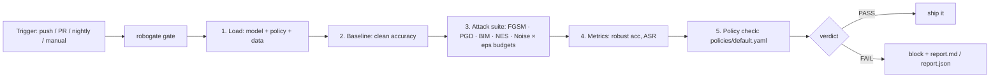

# MLSecOps Robustness Gate

An automated **adversarial-robustness gate** for PyTorch models — the security
check that belongs in every ML pipeline. Every model change runs the same
workflow: baseline accuracy → adversarial attack suite → metrics → policy
verdict → report. PASS ships, FAIL blocks.

```
pip install -r requirements.txt
python examples/quickstart.py   # trains demo model, runs gate, writes report.md/json
pytest                          # logic tests, CPU-only, no downloads
```

## The workflow



Full architecture diagram: [`docs/architecture.svg`](docs/architecture.svg)

Model zoo (`robogate/model_zoo.py`): TinyCNN (default demo), MLP and DeepCNN
for architecture-robustness comparison — see `examples/compare_models.py`.
Chinese intro PDF: [`docs/robogate-intro.pdf`](docs/robogate-intro.pdf).

## What it measures

| Stage | Detail |
|---|---|
| Attacks | FGSM, PGD, BIM (white-box L_inf), NES (black-box, query-only), Noise (random baseline) — pure-PyTorch implementations in `robogate/attacks.py` |
| Budgets | epsilon in {0.05, 0.1, 0.2} by default |
| Metrics | clean accuracy, per-(attack, eps) robust accuracy, attack success rate |
| Policy | YAML thresholds: min robust accuracy per attack, max clean-accuracy drop vs baseline |

## Bring your own model

```python
from robogate import Gate, ATTACKS, load_policy, make_loaders

model = torch.load("model.pt", weights_only=False)  # any nn.Module
_, test_loader = make_loaders()                     # or your own loader
gate = Gate(model, test_loader, ATTACKS, [0.05, 0.1], load_policy("policies/default.yaml"))
results = gate.run()                                # results["verdict"] is PASS or FAIL
```

`examples/quickstart.py` exits non-zero on FAIL, so CI fails the build.
See [`.github/workflows/robogate.yml`](.github/workflows/robogate.yml) for the
drop-in Actions workflow.

## Second threat model: malware evasion

The same gate idea, applied to malware detectors instead of image classifiers.
The attacker perturbs a malware sample so the classifier calls it benign.

| Piece | File |
|---|---|
| Synthetic PE-style features (64 dims; last 16 = appendable overlay region) + `MalwareMLP` detector | `robogate/malware_data.py` |
| Evasion attacks: `FGSMevasion` (white-box, targeted at "benign"), `AppendEvasion` (steers only overlay dims toward the benign centroid — the realistic no-gradient attacker), `RandomEvasion` (baseline) | `robogate/malware_attacks.py` |
| `MalwareGate`: detection rate → evasion suite → evasion rate / robust detection → policy → verdict → Markdown/JSON report | `robogate/malware_gate.py` |

```python
from robogate import (
    DEFAULT_MALWARE_POLICY, MalwareGate, MalwareMLP, benign_centroid,
    make_malware_attacks, make_malware_loaders, train_malware,
)

train_loader, test_loader = make_malware_loaders(n=2000)
model = train_malware(MalwareMLP(), train_loader, epochs=10)
attacks = make_malware_attacks(benign_centroid(train_loader))
results = MalwareGate(model, test_loader, attacks,
                      [0.1, 0.2, 0.3], DEFAULT_MALWARE_POLICY).run()
```

Run it: `python examples/malware_quickstart.py` → `malware_report.md`.
The demo detector hits 100% clean detection but FAILs the gate: FGSM reaches
~99% evasion at eps=0.2, and the gradient-free append attack still reaches
~34% — a detector leaning on easily-spoofed overlay features is evadable.
No real malware is used; plug in EMBER-style features to test a real detector.

Closing the loop with adversarial training: `python examples/malware_defended.py`
trains on FGSM evasions mixed into each batch (`train_malware_adversarial`),
then re-runs the gate — evasion drops to ~5% (FGSM) and ~0.5% (append) at
eps=0.2 and the verdict flips to **PASS**. CI runs this defended gate.

Per-family evasion: `python examples/malware_families.py` trains on a
4-family mixture (ransomware, trojan, worm, spyware — `FAMILY_NAMES` in
`robogate/malware_data.py`) and the report gains a per-family evasion table.
The family with the weakest signature sits closest to the decision boundary
and falls first — in the demo, ransomware hits ~55% append-evasion at eps=0.2
while spyware holds at 0%. Pass `family_names=` to `MalwareGate` to enable it.

## Third threat model: RAG indirect injection

The same gate idea, applied to retrieval-augmented generation. The attacker
poisons a document in the corpus; when it gets retrieved, the LLM follows the
injected instruction instead of just answering the query.

| Piece | File |
|---|---|
| Synthetic doc corpus + queries + stdlib TF-IDF retriever | `robogate/rag_data.py` |
| `RAGSystem` (retriever + generator); `MockGenerator` (naive/defended test double); `OllamaGenerator` (real LLM via Ollama, e.g. llama3.1) | `robogate/rag_targets.py` |
| Poisoned-document attacks: `direct` (plain-text instruction), `hidden` (HTML comment), `authority` (fake policy update); each carries a canary word | `robogate/rag_attacks.py` |
| `RAGGate`: clean accuracy → per-attack poisoned corpora → exposure / injection rate → policy → verdict → Markdown/JSON report | `robogate/rag_gate.py` |

```python
from robogate import (
    DEFAULT_RAG_POLICY, RAG_ATTACKS, RAGGate, RAGSystem,
    MockGenerator, make_corpus, make_queries,
)

def make_system(extra_docs):
    return RAGSystem(make_corpus() + extra_docs, MockGenerator(mode="naive"))

results = RAGGate(make_system, make_queries(), RAG_ATTACKS,
                  DEFAULT_RAG_POLICY).run()
```

Run it: `python examples/rag_quickstart.py` → `rag_report.md`. The naive
system follows every injected instruction (100% injection on exposed queries)
and FAILs the gate; `python examples/rag_defended.py` (generator treats docs
as untrusted data) drops injection to 0% and PASSes. The judge strips
verbatim-quoted doc text before looking for the canary, so merely citing a
poisoned doc doesn't count as following it. Swap `MockGenerator` for
`OllamaGenerator("llama3.1")` to test a real model — same interface.

## Roadmap

- Stronger black-box attacks (Boundary, Square), certified-robustness checks
- Model registry integration (MLflow) and trend dashboards
