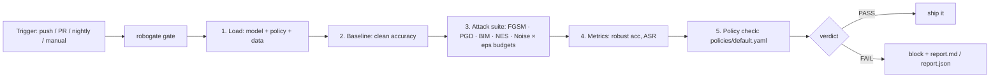

# MLSecOps Robustness Gate

An automated **adversarial-robustness gate** for PyTorch models — the security
check that belongs in every ML pipeline. Every model change runs the same
workflow: baseline accuracy → adversarial attack suite → metrics → policy
verdict → report. PASS ships, FAIL blocks.

```
pip install -r requirements.txt
python examples/quickstart.py   # trains demo model, runs gate, writes report.md/json
pytest                          # logic tests, CPU-only, no downloads
```

## The workflow



Full architecture diagram: [`docs/architecture.svg`](docs/architecture.svg)

## What it measures

| Stage | Detail |
|---|---|
| Attacks | FGSM, PGD, BIM (white-box L_inf), NES (black-box, query-only), Noise (random baseline) — pure-PyTorch implementations in `robogate/attacks.py` |
| Budgets | epsilon in {0.05, 0.1, 0.2} by default |
| Metrics | clean accuracy, per-(attack, eps) robust accuracy, attack success rate |
| Policy | YAML thresholds: min robust accuracy per attack, max clean-accuracy drop vs baseline |

## Bring your own model

```python
from robogate import Gate, ATTACKS, load_policy, make_loaders

model = torch.load("model.pt", weights_only=False)  # any nn.Module
_, test_loader = make_loaders()                     # or your own loader
gate = Gate(model, test_loader, ATTACKS, [0.05, 0.1], load_policy("policies/default.yaml"))
results = gate.run()                                # results["verdict"] is PASS or FAIL
```

`examples/quickstart.py` exits non-zero on FAIL, so CI fails the build.
See [`.github/workflows/robogate.yml`](.github/workflows/robogate.yml) for the
drop-in Actions workflow.

## Roadmap

- Stronger black-box attacks (Boundary, Square), certified-robustness checks
- Model registry integration (MLflow) and trend dashboards
